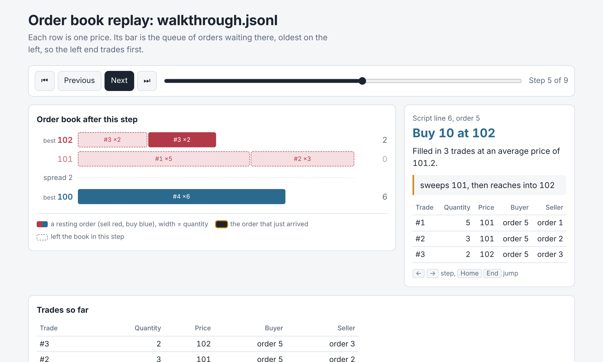

# Market Microstructure Playground

[](https://github.com/SohamMessi10/market-microstructure-playground/actions/workflows/tests.yml)

A limit order book and matching engine, built from scratch to show how buy and sell orders turn
into trades under price-time priority. Write a script of orders and cancels, replay it, and step
through what happened, one event at a time.



*A buy of 10 at 102 arrives. Dashed segments are what it took: all of the 101 queue, oldest
first, then the front of order #3 at 102. The other half of #3 keeps its place.*

## Why

Every stock has two prices, not one: the best price someone will buy at (the **bid**) and the
best price someone will sell at (the **ask**). Every trade comes from one mechanical rule that most
people who trade never see: better prices go first, and at the same price, whoever arrived first
goes first. This project implements that rule exactly, small enough to check by hand, with tests
that prove it never breaks.

It uses one made-up instrument and never connects to a real market or brokerage.

## Try it

Requires Python 3.11 or newer. No other dependencies.

```bash
git clone https://github.com/SohamMessi10/market-microstructure-playground.git
cd market-microstructure-playground
python3 -m venv .venv
source .venv/bin/activate
python -m pip install -e ".[dev]"
python -m pytest
mmp replay examples/queue_priority.jsonl
mmp view examples/queue_priority.jsonl
```

`mmp view` writes `queue_priority.html`, a single page that works offline: open it in any
browser and step through with the buttons or the arrow keys. Ready-made pages for both
examples are in [`docs/demo/`](docs/demo): download one and open it. (GitHub shows `.html` files
as source, so viewing them on github.com shows the code, not the page.)

This is the real output of `mmp replay examples/queue_priority.jsonl`:

```
line  order  event                     bid / ask    result
   2     #1  buy 5 @ 100 (ana)         100 / -      rests 5
   3     #2  buy 5 @ 100 (ben)         100 / -      rests 5
             note: same price as ana, so ben queues behind her
   4     #3  buy 5 @ 101 (cy)          101 / -      rests 5
             note: arrived last but bids higher, so cy goes first
   5     #4  sell 8 @ 100 (dee)        100 / -      filled (5 @ 101 with #3, 3 @ 100 with #1)
             note: fills cy at 101, then ana at 100; ben gets nothing
   6     #1  cancel #1                 100 / -      cancelled 2
             note: ana cancels her last 2
   7     #5  sell 4 @ 100 (eve)        100 / -      filled (4 @ 100 with #2)
             note: now ben is first in line at 100

5 orders, 1 cancel (0 refused), 3 trades, 12 traded
final book:
  bid    100       1  (1 order)
```

Dee's sell first takes cy's 101 bid, which arrived last but pays more (price beats time), then
ana's 100 bid ahead of ben's (time breaks ties). Notice that dee sold at 101 and 100 although she
would have accepted 100: a trade happens at the **resting** order's price.

## Writing a script

One JSON object per line. Blank lines and lines starting with `#` are skipped.

```
{"type": "order", "side": "buy", "price": 100, "quantity": 5, "trader": "ana"}
{"type": "order", "side": "sell", "price": 99, "quantity": 8, "note": "shown in the log"}
{"type": "cancel", "order_id": 1}
```

Prices are whole numbers of ticks. Orders are numbered 1, 2, 3… in the order they appear, which
is what a cancel refers to. A script with any mistake (a misspelled field, a price of `100.5`)
is rejected with every bad line listed, before anything runs. The full format is in
[`docs/design.md`](docs/design.md#script-format).

## The rules

1. **Limit orders:** buy at most, or sell at least, a given price. They wait until filled or cancelled.
2. **Price-time priority:** a better price goes first; at the same price, the earlier order goes first.
3. **An incoming order that crosses** (a buy at or above the best ask, a sell at or below the best
   bid) trades against the best resting orders, one at a time, until it's filled or stops crossing.
4. **The trade price is the resting order's price.** The incoming order can do better than its
   limit, never worse.
5. **Partial fills:** what's left of an incoming order rests at its limit; a partly filled
   resting order keeps its place in the queue.
6. **After matching, the book is never crossed:** best bid < best ask.
7. **Cancelling removes only what hasn't traded.** Cancelling an unknown or finished order is
   refused with a reason, and a replay carries on.

Simplified on purpose: no market orders, order changes, self-trade prevention, fees, or auctions.
[`docs/walkthrough.md`](docs/walkthrough.md) works through a sequence of trades by hand, and a
test replays it to check every number.

## How it works

```
 script.jsonl ──► replay.py ──► MatchingEngine (engine.py) ──► results, trades ──► text, JSON, or HTML page
                  strict parse     │ the rules: matching, cancels,                 (replay.py, view.py)
                  all lines first  │ ids, a record for every order
                                   ▼
                                 Book (book.py)
                                   bids and asks: price → queue of orders, oldest first
```

| Need | Data structure | Cost |
|---|---|---|
| The queue at one price: add, take the oldest, cancel any | insertion-ordered `dict` | O(1) each |
| The best price on a side | sorted list of prices with `bisect` | O(1) to read; O(levels) to add or drop a level |
| Find an order to cancel | `dict` from id to order | O(1) |

The **book** is only a data structure: it refuses an insert that would cross, because matching is
the **engine's** job. Order ids and arrival numbers come from one counter in the engine, never a
clock, so the same script always produces the same trades.

## Testing

195 tests (181 plus 14 browser tests that need the optional `.[browser]` extra), run in CI on
Python 3.11–3.14 on Linux, 3.13 on macOS, and in Chromium.

- **A second, deliberately simple engine** (`tests/reference.py`: one flat list, searched in full
  for every fill) shares no code with the real one. On thousands of random order sequences, both
  must produce identical trades and identical books after every event.
- **Stateful property tests** (Hypothesis) interleave orders, cancels of any earlier order, and
  cancels of orders that never existed, and check after every step that each order's quantity
  adds up: original = traded + resting + cancelled.
- **Invariant checks** after every event: queues in arrival order, totals that match, an index
  that matches the book, and a book that's never crossed. The checker has tests of its own: 23
  deliberate corruptions it must catch.
- **Golden files:** the examples' output was checked by hand, saved, and must be reproduced exactly.
- **Browser tests:** stepping, keyboard, the ladder's segments, hostile script text, and every
  step of both examples at phone, tablet and desktop widths in light and dark mode.
- **Mutation testing, by hand:** more than 60 deliberate bugs across the project, each of which
  must make a test fail. The ones that didn't led to new tests.

Measuring the random tests mattered too. The first generators never had one order trade against
more than 3–4 resting orders; a generator that builds a deep book first now drives single orders
through up to 11 price levels in 12 trades.

## Performance

Single thread, CPython 3.13, Intel Xeon @ 2.30 GHz (2 CPUs), medians of 5 runs, three separate runs:

| Workload (200,000 events, fixed seed) | Events per second |
|---|---:|
| typical: passive orders near a drifting mid, 10% aggressive, 20% cancels | 188,000 – 209,000 |
| deep book: almost 20,000 price levels | 227,000 – 236,000 |

Against the simple reference engine, the gap grows with the book, from 6× (2,000 events) to 64×
(20,000 events), because the reference searches every resting order on each fill. Two design
questions were settled by measurement rather than assumption: the sorted price list is not a
bottleneck even at 20,000 levels, and an optimization a profile suggested made no measurable
difference, so it was reverted. Details, workloads and caveats: [`docs/benchmark.md`](docs/benchmark.md).
Run `python benchmarks/bench.py` to measure your own machine.

## The replay page

`mmp view` writes one self-contained HTML file. Each price is a row, and its bar is that price's
queue: one segment per order, oldest on the left. Whatever left the book in a step stays as a
dashed segment in its exact place, and the new order is outlined, so you can watch the front of
the queue being eaten. It works with the keyboard and on a phone, and follows the system's light
or dark mode.

It's safe to open a page made from someone else's script. Their text is escaped and inserted only
as text, never as HTML, and a Content-Security-Policy stops the page from loading anything from
anywhere. Browser tests try a note containing `</script><script>alert(1)</script>`.

## Limitations

- **One instrument, limit orders only.** No market orders, stop orders, order changes, auctions,
  fees, or self-trade prevention.
- **In memory, single threaded.** Nothing is saved; there is no network interface. Records of
  finished orders are kept for the whole run, which is fine for replaying scripts.
- **Synthetic data.** The benchmark workloads are generated, not real market data.
- **The replay page** handles up to 2,000 events and draws up to 30 orders per price level.

## Possible extensions

Market orders with explicit empty-book handling; a simulated market maker; a C++ matching core
behind the same tests and reference engine; replaying real exchange data formats.

## More

- [`docs/design.md`](docs/design.md): rules, invariants, architecture, script format, the page.
- [`docs/walkthrough.md`](docs/walkthrough.md): trades worked out by hand.
- [`docs/benchmark.md`](docs/benchmark.md): measurements and what they showed.
- [`PROGRESS.md`](PROGRESS.md): how it was built, milestone by milestone, with every bug found.

## License

[MIT](LICENSE)
